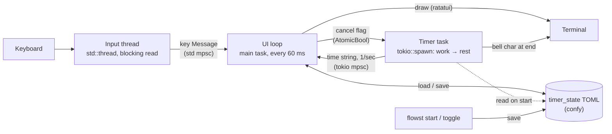

# Kavana (formerly Flowst)

A Pomodoro timer for the terminal, written in Rust. Run it as a full-screen terminal app or as a one-line command. Set your own work and rest intervals, save them as presets, and hear a bell when each interval ends.


I built Flowst in summer 2023 to teach myself Rust. In March 2026 I reread the code and filed every problem I found as an issue. See [Code review (March 2026)](#code-review-march-2026).

## What is the Pomodoro Technique?

You work for a set period, then take a shorter break, and repeat until the work is done. The classic split is 25 minutes of work and 5 minutes of rest. Flowst lets you pick any ratio. I usually use 50/10.

## Features

- **Timer control:** start, pause, and reset work and rest intervals.
- **Terminal app:** shows the timer, your saved configurations, the logo, and the key controls.
- **Presets:** save, load, reset, and scroll through timer configurations.
- **Keyboard controls** for the timer and for moving around the app.
- **Bell** at the end of each interval.

## Install

**macOS (Homebrew):**

```
brew tap ben-toker/flowst
brew install flowst
```

The Homebrew version may be behind this branch. For the latest code, build from source.

**From source (macOS, Linux, Windows):** install the Rust toolchain, then run:

```
git clone https://github.com/ben-toker/flowst.git
cd flowst
cargo build --release
```

The binary is at `target/release/flowst`. There is no Windows package yet, but friends on Windows report that building from source works.

## Usage

```
# Show the command-line help
flowst

# Start a standard 25/5 timer
flowst start

# Start a custom timer: 40 minutes of work, 20 of rest
flowst start -w 40 -r 20

# Pause or resume the saved timer
flowst toggle

# Reset the saved configuration file
flowst reset

# Open the full terminal app
flowst app
```

Use `flowst app` (or `cargo run app`) for the full experience. The bell plays only while the app is open, so open a second terminal tab if you need a shell. A background daemon is outside this project's scope.

## How it works

Flowst runs on a single-threaded tokio runtime plus one native OS thread. The native thread calls crossterm's `event::read()` and sends key presses to the main loop over a `std::sync::mpsc` channel. It's a plain thread because `event::read()` blocks, and blocking inside a single-threaded async runtime would freeze the timer.

The countdown is a spawned tokio task that runs the work interval and then the rest interval. Once a second it sends a formatted "time remaining" string over a bounded `tokio::sync::mpsc` channel. The UI loop wakes every 60 ms, checks both channels with `try_recv`, and redraws with ratatui.

Timer state (`TimerInfo`: durations, start timestamps, pause time, running flag) is stored on disk as TOML through confy, and serde handles the chrono types. The command-line commands and the app share that one file. `start_timer` works out the remaining time from wall-clock timestamps rather than keeping a counter in memory.

Pausing records `pause_time`, sets a shared `Arc<AtomicBool>` cancel flag so the running task exits, and spawns a replacement task that shows the frozen time. Resuming subtracts the time already used from the current interval, resets that interval's start to now, and starts a new countdown. Choosing a preset follows the same pattern: cancel, overwrite the file, restart. When a countdown reaches zero without being cancelled, it prints the bell character (`\x07`), so the sound comes from the terminal itself.



Built with tokio, ratatui, crossterm, clap, serde, confy, and chrono.

## Code review (March 2026)

In March 2026 I reviewed the code I wrote while learning Rust and filed each problem as an issue. These are still open.

**Bugs**

- [#26](https://github.com/ben-toker/flowst/issues/26): `pause_time` is set incorrectly on a new running timer.
- [#27](https://github.com/ben-toker/flowst/issues/27): off-by-one match on the `list_state` selected index.

**Performance**

- [#11](https://github.com/ben-toker/flowst/issues/11): the render loop loads the config from disk every frame.

**Code quality** (tracked in [#18](https://github.com/ben-toker/flowst/issues/18))

- [#13](https://github.com/ben-toker/flowst/issues/13): centralize duplicated preset definitions.
- [#14](https://github.com/ben-toker/flowst/issues/14): extract the duplicated pause and resume time calculation.
- [#15](https://github.com/ben-toker/flowst/issues/15): remove dead code and unused dependencies.
- [#16](https://github.com/ben-toker/flowst/issues/16): replace `.unwrap()` calls with proper error handling.
- [#17](https://github.com/ben-toker/flowst/issues/17): improve naming across the codebase.
- [#19](https://github.com/ben-toker/flowst/issues/19): make `TimerInfo` fields private and add constructors.
- [#20](https://github.com/ben-toker/flowst/issues/20): add unit tests.
- [#21](https://github.com/ben-toker/flowst/issues/21): reduce tokio feature flags.

<!-- TODO (Ben): as you close issues, move them under a "Fixed" heading with one line on what you changed. -->

## Roadmap

The core app is done. Possible additions:

- Use the `cassowary` crate for layout constraints so the interface scales cleanly.
- Add sound or music while working. `get_sound` in `lib.rs` already exists but isn't connected to the interface yet.
- Add a work log.
